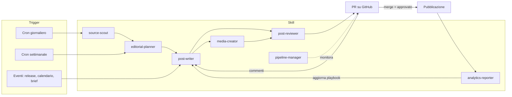

# Brainstorming: comunicazione LinkedIn agentica

> Stato: **brainstorming iniziale, superato** — le decisioni sono in `02-processo-operativo.md`.
> Data: 2026-10-26

---

## 1. Obiettivo e principi guida

**Obiettivo:** un sistema di skill + task periodici che gestisca in modo agentico l'intero ciclo della comunicazione LinkedIn aziendale: dalla scoperta delle fonti alla misurazione dei risultati, con l'umano coinvolto solo nei punti di controllo che contano.

**Principi proposti**

1. **Il repository è la fonte di verità.** Ogni contenuto è un file (Markdown + frontmatter YAML) con il suo stato. Tutto è versionato, diffabile, leggibile sia da persone che da agenti.
2. **La Pull Request è il gate di approvazione.** L'agente apre una PR con bozza + media; l'umano commenta o approva; il merge = "approvato". I commenti nella PR vengono ripresi dall'agente che rivede la bozza.
3. **Autonomia progressiva.** Si parte con approvazione umana su tutto; si allenta per tipo di contenuto man mano che i dati di review dimostrano affidabilità (vedi §7).
4. **Nessun numero senza fonte.** Ogni dato citato in un post deve avere URL + citazione testuale salvati nel file del contenuto.
5. **Il ciclo si chiude con i dati.** Le analytics alimentano le linee guida (cosa funziona → playbook aggiornato), non solo un report.

---

## 2. Tipologie di contenuto

| # | Tipo | Cosa fa scattare il contenuto | Input necessari | Formato suggerito | Gate umano | Frequenza indicativa |
|---|------|------------------------------|-----------------|-------------------|------------|---------------------|
| 1 | **Marketing piattaforma** | Calendario editoriale (pianificato) | Doc prodotto, casi d'uso, value proposition, FAQ clienti | Carosello PDF, immagine + testo | Approvazione finale | 1/settimana |
| 2 | **Commento report di mercato** | Source scouting (nuovo report rilevante) | URL report, dati chiave + citazioni, punto di vista aziendale | Testo + grafico ricreato, carosello "5 dati chiave" | Approvazione + fact-check dei numeri | 1/settimana |
| 3 | **Partecipazione a eventi** | Evento in agenda (registro eventi / calendario) | Nome, date, stand/talk, speaker, foto dal team | Sequenza: *pre* (banner/annuncio), *live* (foto), *post* (recap + learnings) | Approvazione; foto fornite dal team | 2–3 post per evento |
| 4 | **Rilascio nuove feature** | Release note / changelog / tag di rilascio | Release note, screenshot, data di embargo, beneficio per l'utente | Screenshot annotati, GIF/video breve, carosello "prima/dopo" | Product + marketing; rispetto embargo | Per release rilevante |
| 5 | **Annunci di partnership** | Intake manuale (brief) | Brief partner, loghi, quote approvate, data annuncio, handle LinkedIn del partner | Immagine co-branded | Obbligatorio, anche lato partner | Ad hoc |

**Tipologie aggiuntive da valutare** ❓

- **Customer story / case study** — tra i formati più credibili per una piattaforma B2B.
- **Educational / how-to** — post "come fare X con la piattaforma"; ottimo per riciclare documentazione.
- **Milestone aziendali** — numeri, round, assunzioni, premi.
- **Team & cultura / hiring** — umanizzano la pagina.
- **Riciclo evergreen** — riproporre i post migliori in un nuovo formato dopo 3–6 mesi.

---

## 3. Funzionalità del sistema (brainstorming)

Per ciascun processo: cosa fa, come può funzionare, e il livello di priorità proposto (**MVP** / **Fase 2** / **Fase 3**).

### 3.1 Source scouting — *MVP*

- Ricerca web periodica su: report di mercato (società di analisi, consulenza, associazioni di settore), news di settore, competitor, calendari eventi.
- Lista di fonti curate (`config/sources.yaml`): siti, feed RSS, parole chiave, competitor.
- Ingestione di **Google Alerts / newsletter via email** (la casella email è già collegabile tramite MailMCP).
- **Scoring** di ogni segnale: rilevanza per l'ICP, freschezza, autorevolezza della fonte, "angolo" possibile per l'azienda.
- Output: `inbox/signals/YYYY-MM-DD.md` con i segnali ordinati per punteggio; i migliori diventano proposte di idea.
- Anti-duplicazione: non riproporre fonti già usate o scartate.

### 3.2 Pipeline management — *MVP*

- Ogni contenuto è una cartella `pipeline/<anno>/<settimana>-<slug>/` con `post.md` (frontmatter: tipo, stato, pilastro, data slot, owner, fonti, asset) e i suoi media.
- Stati proposti:

  `signal → idea → planned → drafting → agent-review → human-review → approved → scheduled → published → measured → archived`

- **Calendario editoriale**: vista generata (Markdown + export Excel `calendar.xlsx` per chi non usa GitHub).
- **Controllo blocchi**: segnala contenuti fermi in uno stato oltre N giorni, slot vuoti nel calendario, sbilanciamento tra pilastri (es. troppo prodotto, poca thought leadership).
- Alternativa da valutare ❓: GitHub Issues + Projects come board. Proposta: file come fonte di verità, eventualmente sincronizzati con una board.

### 3.3 Content creation — *MVP*

- Una skill di scrittura con **template specifici per ciascun tipo** (§2) e un brief strutturato in input.
- Si appoggia a:
  - `brand/voice.md` — tono, lessico, cose da dire/non dire, lista anti-cliché "da AI".
  - `brand/company-context.md` — chi siamo, prodotto, ICP, messaggi chiave, proof point.
  - `brand/playbook.md` — cosa funziona su LinkedIn per noi (aggiornato dalle analytics).
- Produce **2–3 varianti di hook** e una versione finale; lingua IT/EN o entrambe ❓.
- Suggerisce tag (partner, persone, aziende), hashtag (3–5) e primo commento (es. link esterno).

### 3.4 Review — *MVP*

Review dell'agente **prima** dell'umano, con checklist e punteggio:

- **Fattuale**: ogni numero/claim ha una fonte salvata e corrispondente.
- **Brand**: coerenza con `voice.md`, assenza di frasi vietate e cliché.
- **Rischio**: embargo rispettato, nomi di clienti/partner autorizzati, nessuna informazione riservata, diritti sulle immagini.
- **Efficacia LinkedIn**: hook nelle prime ~2 righe (prima del "…vedi altro"), lunghezza, leggibilità mobile, call to action.
- Esito: `review.md` nella cartella del contenuto + commento riassuntivo nella PR.
- Poi **review umana in PR**: i commenti vengono letti dall'agente che produce una nuova versione.

### 3.5 Media creation — *Fase 2* (template base già in MVP)

- **Template HTML brandizzati → PNG/PDF** (rendering con browser headless): quote card, card "dato chiave", banner evento, annuncio partnership co-branded, copertina feature.
- **Caroselli PDF** (document post): formato molto efficace su LinkedIn per contenuti educativi e report.
- **Grafici** ricreati dai dati dei report (mai copiare le immagini originali: si ricrea con citazione della fonte).
- **Screenshot annotati** per le feature (input: screenshot forniti dal team prodotto).
- Più avanti: GIF/video brevi, generazione immagini con modelli esterni ❓.
- Kit grafico in `brand/assets/` (logo, palette, font, template).

### 3.6 Reach analytics — *MVP manuale → Fase 2 automatico*

- **MVP**: export manuale da LinkedIn Page Analytics (file XLS) caricato in `analytics/raw/`; l'agente lo analizza.
- **Fase 2**: raccolta automatica via LinkedIn Community Management API (richiede app LinkedIn approvata con accesso alla pagina) o tramite il tool di scheduling, se ne usate uno.
- Metriche: impression, reach, engagement rate, click, follower acquisiti, commenti; suddivise per **tipo, pilastro, formato, giorno/ora, lunghezza, tipo di hook**.
- Metriche di processo: tempo da idea a pubblicazione, numero di revisioni, % approvato al primo giro.
- Output: report settimanale breve + report mensile con raccomandazioni che **aggiornano `brand/playbook.md`** tramite PR.

### 3.7 Publishing / scheduling — *Fase 3*

- Opzioni:
  1. **Manuale assistito**: l'agente prepara un "pacchetto pronto" (testo, media, primo commento, orario) e notifica; una persona pubblica. Zero rischi, zero integrazioni.
  2. **Tool di scheduling** (Buffer, Hootsuite, Metricool, ecc.) via API: l'agente crea la bozza programmata.
  3. **LinkedIn API diretta** (Community Management API): massima automazione, richiede approvazione dell'app da parte di LinkedIn.
- Regola: **mai automazioni non ufficiali** (scraping, bot sul browser) su LinkedIn — rischio di blocco dell'account.

### 3.8 Idee aggiuntive

- **Employee advocacy**: versioni dello stesso contenuto adattate ai profili personali di founder/team (di solito hanno molta più reach della pagina aziendale) ❓.
- **Competitor watch**: monitoraggio mensile di cosa pubblicano i competitor e cosa funziona per loro.
- **Gestione commenti**: bozze di risposta ai commenti sui post (Fase 3, richiede API).
- **Notifiche**: email o Slack quando c'è una PR da approvare, un evento in arrivo o un contenuto bloccato.
- **Intake da documenti**: brief partner o release note in Word/PDF caricati in `inbox/` diventano automaticamente bozze.

---

## 4. Architettura proposta



### Skill (in `.claude/skills/`)

| Skill | Responsabilità | Fase |
|-------|----------------|------|
| `brand-voice` | Skill di riferimento: tono, lessico, regole, contesto aziendale | MVP |
| `source-scout` | Trova, valuta e salva segnali dalle fonti | MVP |
| `editorial-planner` | Trasforma segnali e richieste in idee e le assegna agli slot del calendario | MVP |
| `post-writer` | Scrive bozze per tipo di contenuto con template dedicati | MVP |
| `post-reviewer` | Checklist fattuale/brand/rischio/efficacia, punteggio | MVP |
| `media-creator` | Immagini, caroselli PDF, grafici da template brandizzati | Fase 2 |
| `pipeline-manager` | Stati, blocchi, calendario, export Excel | MVP |
| `analytics-reporter` | Analisi metriche e aggiornamento del playbook | MVP (manuale) |
| `release-to-post` | Da release note/changelog a post feature | Fase 2 |
| `event-kit` | Sequenza pre/live/post evento | Fase 2 |
| `partnership-kit` | Annuncio co-branded con checklist approvazioni partner | Fase 2 |
| `publisher` | Pacchetto di pubblicazione / scheduling | Fase 3 |

### Task periodici (proposta di calendario)

| Quando | Task | Output |
|--------|------|--------|
| Ogni giorno, mattina | Source scouting leggero | Segnali in `inbox/signals/` |
| Ogni giorno | Controllo pipeline (bloccati, scadenze, embargo) | Notifica solo se c'è qualcosa da fare |
| Lunedì | Pianificazione settimanale | Slot della settimana assegnati + bozze avviate → PR |
| Martedì–giovedì | Produzione bozze + media + review agente | PR pronte per la review umana |
| Venerdì | Report analytics settimanale | `analytics/reports/` + note per il playbook |
| Primo del mese | Retrospettiva + competitor watch + aggiornamento playbook | PR su `brand/playbook.md` |
| Su evento | Nuova release, evento a 2 settimane, brief partnership caricato | Avvio del kit dedicato |

I task periodici sono sessioni Claude Code pianificate che lavorano su questo repository, invocano una skill e aprono una PR.

---

## 5. Struttura del repository (proposta)

```
.
├── .claude/skills/          # una cartella per skill, ognuna con SKILL.md + template
├── brand/
│   ├── company-context.md   # chi siamo, prodotto, ICP, messaggi chiave
│   ├── voice.md             # tono, do/don't, anti-cliché
│   ├── playbook.md          # cosa funziona (aggiornato dalle analytics)
│   └── assets/              # logo, palette, font, template grafici
├── config/
│   ├── sources.yaml         # fonti, keyword, competitor
│   ├── calendar-rules.yaml  # frequenze, mix tra pilastri, giorni/orari
│   └── events.yaml          # registro eventi
├── inbox/                   # signals/, briefs/ (Word/PDF in ingresso), releases/
├── pipeline/<anno>/<sett>-<slug>/
│   ├── post.md              # testo + frontmatter di stato
│   ├── review.md
│   └── assets/
├── analytics/               # raw/ (export), reports/
├── exports/                 # calendar.xlsx e altre viste per non-tecnici
└── docs/                    # documentazione del processo
```

---

## 6. Rischi e guardrail

| Rischio | Mitigazione |
|---------|-------------|
| Numeri inventati o citati male | Fonte + citazione obbligatorie; il reviewer verifica ogni numero |
| Copyright su grafici e immagini dei report | Ricreare i grafici dai dati con citazione; mai copiare immagini |
| Annunci prematuri (feature, partnership) | Campo `embargo_until` nel frontmatter; blocco automatico prima della data |
| Partner o clienti nominati senza consenso | Campo `approvals` obbligatorio per i tipi 4 e 5 |
| Testo "che sembra scritto da un'AI" | Lista anti-cliché in `voice.md`, varianti di hook, review umana |
| Account LinkedIn penalizzato | Solo API ufficiali o tool approvati; niente scraping |
| Volume a scapito della qualità | Frequenza fissata in `calendar-rules.yaml`; meglio meno post migliori |
| Dati personali (tag di persone, foto) | Consenso per foto e tag di dipendenti/persone esterne |

---

## 7. Livelli di autonomia

| Livello | Cosa decide l'agente | Cosa decide l'umano |
|---------|----------------------|---------------------|
| **L0 – Assistito** (avvio) | Scouting, bozze, media, review | Approvazione di ogni idea e ogni post |
| **L1 – Supervisionato** | Sceglie le idee da sviluppare | Approvazione finale di ogni post |
| **L2 – Autonomo su tipi a basso rischio** | Pubblica commenti ai report e contenuti educational sopra una soglia di punteggio | Approvazione su feature, partnership, eventi |
| **L3 – Autonomo** | Tutto tranne partnership e annunci riservati | Review a campione + report mensile |

Passaggio di livello basato su dati: es. ≥ 90% dei post approvati senza modifiche sostanziali per 4 settimane.

---

## 8. Roadmap proposta

**Fase 0 – Fondamenta (1 settimana)**
- Contesto aziendale, voice, primi template per tipo, struttura del repo, fonti iniziali.

**Fase 1 – MVP (2–3 settimane)**
- `source-scout`, `editorial-planner`, `post-writer`, `post-reviewer`, `pipeline-manager`.
- Approvazione via PR, pubblicazione manuale, analytics da export manuale.
- Template grafici base (quote card, card dato).

**Fase 2 – Media ed eventi**
- `media-creator` completo (caroselli, grafici), `release-to-post`, `event-kit`, `partnership-kit`.
- Analytics automatiche se disponibile un accesso API.

**Fase 3 – Pubblicazione e ciclo di apprendimento**
- `publisher` (tool di scheduling o API LinkedIn), gestione commenti, employee advocacy, passaggio a L2.

---

## 9. Domande aperte ❓

1. **Azienda e pubblico**: cosa fa la piattaforma, chi è il pubblico target (ruoli, settori, paesi)?
2. **Lingua**: italiano, inglese o entrambi?
3. **Canali**: solo pagina aziendale o anche profili personali di founder/team?
4. **Frequenza**: quanti post a settimana come obiettivo?
5. **Approvazioni**: chi approva? Una persona sola o diversa per tipo (es. product per le feature)?
6. **Strumenti già in uso**: tool di scheduling, Canva/Figma, Slack/Notion/email per le notifiche, accesso admin alla pagina LinkedIn?
7. **Fonti delle feature**: da dove arrivano le release note (changelog, Linear/Jira, GitHub, documento)?
8. **Brand kit**: esistono logo, palette, font, linee guida? Post passati da usare come riferimento di tono?
9. **Fonti di mercato**: pubblicazioni, analisti, competitor e eventi da monitorare?
10. **Pipeline**: ok a usare i file nel repo come fonte di verità + PR come approvazione, o preferite una board (GitHub Projects / Notion)?
