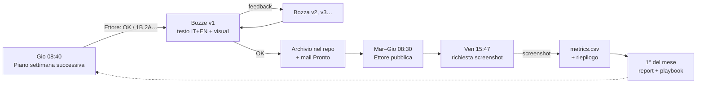

# Processo operativo

> Sostituisce le parti aperte di `01-brainstorming-processo.md` con le decisioni prese il 2026-10-27.
> Le voci **DA CONFERMARE** sono segnate anche in `config/calendar.yaml`.

## Decisioni

| Tema | Decisione |
|---|---|
| Canali | Pagina gCASTEL (3 post/settimana) + profilo di Gilberto Castelluzzo (1/settimana, **DA CONFERMARE**) |
| Lingue | Italiano + inglese. Modalità di pubblicazione EN **DA CONFERMARE** (`bilingual_mode`) |
| Approvazione | Pagina: Ettore. Profilo di Gilberto: Gilberto, tramite Ettore |
| Canale di approvazione | Email via MailMCP: da `Beatrice@gcastel.com` a `ettorezauli@gmail.com`, solo lui. Protocollo: `protocollo-email.md` |
| Repository | Solo materiale approvato (`content/`), più configurazione, skill, brand, metriche |
| Media | Template con il design system **Castel** di Claude Design, resi in PNG/PDF; Claude Design per visual su misura |
| Pubblicazione | Manuale (Ettore / Gilberto) a partire dalla mail "Pronto da pubblicare" |
| Analytics | Il venerdì il sistema chiede gli screenshot; Ettore risponde; le metriche vanno in `analytics/` |
| Report e spunti da Ettore | Email con tag `[REPORT]`, `[IDEA]`, `[FEATURE]`, `[EVENTO]`, `[PARTNERSHIP]`, `[GILBERTO]` |
| Nuove feature | Le comunica Ettore (`[FEATURE]`); nessuna integrazione automatica |

## Settimana tipo

| Quando | Cosa succede | Chi deve agire |
|---|---|---|
| **Giovedì 08:40** | Piano della settimana successiva (3 slot pagina + slot Gilberto, A/B/C) | Ettore risponde |
| Lun–ven 09:07 · 13:07 · 17:07 | Giro della casella: risposte, nuove bozze, revisioni, approvazioni, intake | — |
| Giro delle 17:07 | Promemoria per gli slot di domani non ancora approvati | Ettore, se arriva un promemoria |
| Dopo ogni OK | Post archiviato in `content/` + mail "Pronto da pubblicare" | Ettore / Gilberto pubblicano |
| **Venerdì 15:47** | Richiesta degli screenshot della settimana | Ettore risponde con gli screenshot |
| **1° del mese 10:07** | Report mensile + proposte di modifica al playbook | Ettore approva le proposte |

Tempi: con il piano il giovedì, le bozze arrivano giovedì/venerdì e vanno approvate entro il giorno prima di ogni slot.

## Task pianificati

Sessioni Claude Code che partono da sole su questo repository (fuso orario Europe/Rome). Ognuna invoca una skill.

| Task | Pianificazione | Skill | Esecuzioni/settimana |
|---|---|---|---|
| Giro casella | lun–ven 09:07, 13:07, 17:07 | `linkedin-inbox` | 15 |
| Piano settimanale | giovedì 08:37 | `linkedin-planner` (+ `source-scout`) | 1 |
| Richiesta statistiche | venerdì 15:47 | `linkedin-analytics` (richiesta) | 1 |
| Report mensile | giorno 1, 10:07 | `linkedin-analytics` (mensile) | ~0,25 |

**Prerequisiti per attivarli**
1. Questo lavoro deve essere unito su `main` (i task partono da `main`).
2. I task devono avere il connettore MailMCP.
3. Il test del canale email deve andare a buon fine, inclusa la lettura di uno screenshot allegato.

## Livelli di autonomia

Si parte da **L0**: ogni post è approvato da Ettore (o da Gilberto). Proposta di passaggio a L1 (il sistema sceglie da solo le opzioni del piano) dopo 4 settimane con ≥ 90% di post approvati al primo o secondo giro. La pubblicazione resta manuale.

## Componenti

| Componente | Dove |
|---|---|
| Skill | `.claude/skills/*/SKILL.md` |
| Contesto, guardrail, voce, playbook | `brand/` |
| Design system (copia locale) | `brand/tokens.json`, `brand/assets/` |
| Renderer dei visual | `media/render.cjs` |
| Mail | `scripts/email_body.py` |
| Archivio post approvati | `content/`, `scripts/archive_post.py` |
| Metriche | `analytics/` |
| Configurazione | `config/` |
